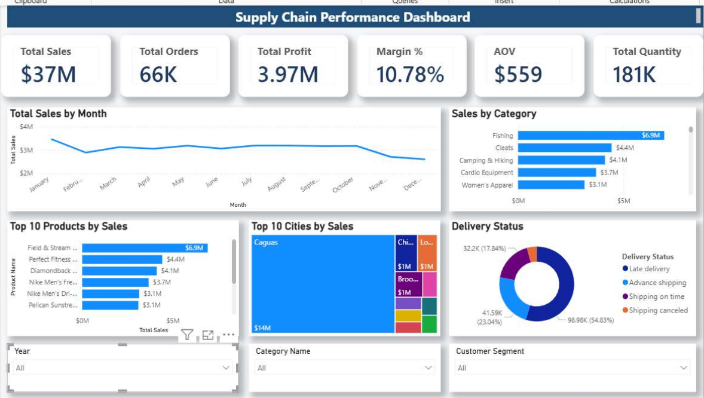
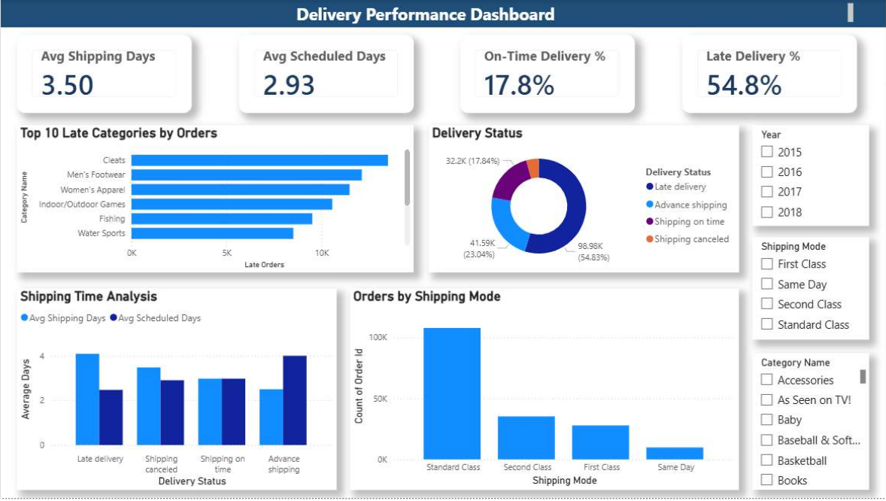
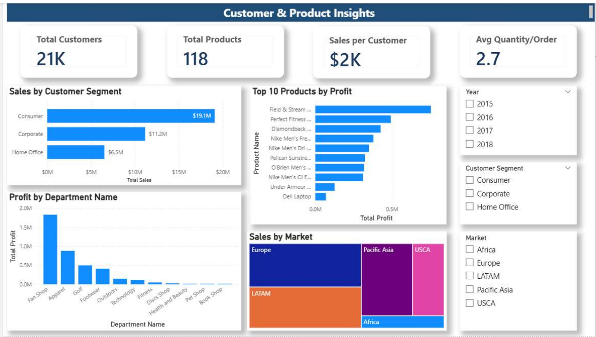

# Supply Chain & Delivery Intelligence Dashboard

An interactive Power BI dashboard for analyzing supply chain performance across sales, profitability, delivery operations, and customer behavior.

## Overview

This project uses the DataCo Smart Supply Chain dataset to explore operational and commercial performance. The dashboard brings key metrics and visualizations together to help users identify trends, monitor delivery efficiency, compare product and market performance, and support data-informed decisions.

## Objectives

- Track sales, orders, profit, and profit margin.
- Monitor shipping performance and late deliveries.
- Identify high-performing products, categories, markets, and customer segments.
- Compare department profitability and customer purchasing behavior.
- Provide interactive views with filters for exploring the data.

## Tools & Technologies

- **Power BI Desktop** — dashboard development and data visualization
- **Power Query** — data cleaning and transformation
- **DAX** — measures and KPI calculations
- **Data modeling** — star-schema design
- **CSV** — source data format

## Dashboard Pages

### 1. Supply Chain Overview

**Key metrics**
- Total Sales
- Total Orders
- Total Profit
- Profit Margin
- Average Order Value (AOV)
- Total Quantity Sold

**Visualizations**
- Monthly sales trends
- Sales by category
- Top products by sales
- Top cities by sales
- Delivery status breakdown

### 2. Delivery Performance

**Key metrics**
- Average Shipping Days
- Average Scheduled Days
- Late Delivery Rate
- On-Time Delivery Rate

**Visualizations**
- Delivery status breakdown
- Actual versus scheduled shipping time
- Categories with the most late deliveries
- Orders by shipping mode

### 3. Customer & Product Insights

**Key metrics**
- Total Customers
- Total Products
- Sales per Customer
- Average Quantity per Order

**Visualizations**
- Sales by customer segment
- Top products by profit
- Profit by department
- Sales by market

## Data Model

The project uses a star-schema approach with the following tables:

- `Fact_Orders`
- `Dim_Customers`
- `Dim_Products`
- `Dim_Date`

The model supports filtering and DAX-based calculations across orders, customers, products, and dates.

## Key Analysis Areas

- Compare sales and profitability across categories, products, departments, and markets.
- Monitor on-time and late delivery rates.
- Compare actual shipping duration with scheduled shipping duration.
- Explore purchasing behavior across customer segments.
- Identify areas of strong performance and possible operational improvement.

## Dataset

This project uses the **DataCo Smart Supply Chain Dataset**, available on Kaggle:

[Download the dataset](https://www.kaggle.com/datasets/shashwatwork/dataco-smart-supply-chain-for-big-data-analysis)

The dataset is not included in this repository because of GitHub file-size limitations. Download it from Kaggle and follow the data-loading steps in your local Power BI setup.

## Skills Demonstrated

- Data cleaning and transformation
- Data modeling and star-schema design
- DAX measure creation
- KPI development
- Interactive dashboard design
- Supply chain and delivery analytics
- Business intelligence and data visualization

## Future Improvements

- Add drill-through pages for deeper analysis.
- Create dynamic tooltips for additional context.
- Configure row-level security (RLS).
- Publish the report to Power BI Service.
- Optimize layouts for mobile viewing.

---

**Project:** Supply Chain & Delivery Intelligence Dashboard  
**Tools:** Power BI, Power Query, DAX  
**Dataset:** DataCo Smart Supply Chain Dataset